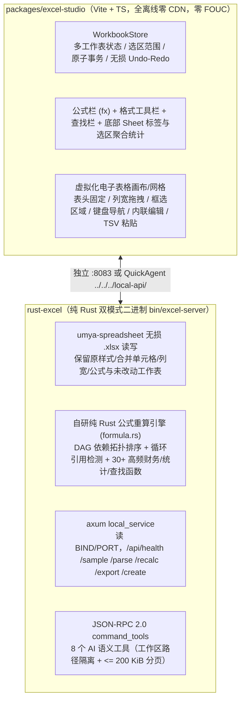

# `excel-editor-engine` 架构与分阶段实施计划

> **目标仓库**：`/home/goodtime/project/excel-editor-engine`（远端：`https://github.com/hahaliangchen/excel-editor-engine.git`）
> **宿主集成目标**：QuickAgent 模块化随包插件 `/home/goodtime/Documents/project/codex-workspace-mcp/bundled_plugins/excel/`（放入即自动点亮「办公创作台」的 **Excel 表格** 卡片，并向 AI 提供 8 个结构化电子表格与公式工具）。

---

## 1. 核心架构与技术选型

只支持 **`.xlsx`（OOXML SpreadsheetML）**，走纯 Rust 无损内核 + 高性能虚拟化网格前端路线，**零 Python / 零 LibreOffice 依赖**：



---

## 2. 目录结构规范

```text
/home/goodtime/project/excel-editor-engine/
├── package.json                      # scripts: dev / build / preview / typecheck / test / backend / test:browser
├── tsconfig.base.json
├── README.md
├── docs/PLAN.md
├── packages/
│   └── excel-studio/                 # 电子表格工作台前端
│       ├── package.json              # vite, vitest, typescript（轻量零重型黑盒表格框架，完全可控）
│       ├── tsconfig.json
│       ├── vite.config.ts            # base: "./"，独立抽离 CSS，禁止 FOUC
│       ├── index.html
│       ├── public/excel.svg
│       ├── src/
│       │   ├── main.ts               # 应用装配与全局快捷键
│       │   ├── model.ts              # Workbook / Sheet / Cell / CellStyle / Range 类型与 A1 坐标工具（A1 <-> row/col）
│       │   ├── store.ts              # 不可变 WorkbookStore + 无损事务 Undo/Redo 历史栈 + 选区聚合统计（计数/求和/均值/最值）
│       │   ├── api-client.ts         # 自动适配独立模式(:8083)与 QuickAgent ../../../local-api/
│       │   ├── grid.ts               # 虚拟化电子表格网格（固定行列头、框选、键盘导航、内联编辑、列宽拖拽、合并单元格、TSV 复制粘贴）
│       │   ├── components/           # 顶栏格式条、公式栏 fx、查找浮条、底部工作表标签栏、选区状态栏
│       │   └── styles/studio.css     # 克制耐看的浅色纸面 + 深色墨韵双主题
│       └── tests/
│           └── store.test.ts         # A1 坐标换算、单元格/区域写入、撤销重做、行列增删、工作表管理、选区聚合单测
│
├── rust-excel/                       # 纯 Rust .xlsx 引擎（独立 Cargo crate）
│   ├── Cargo.toml                    # axum, tokio, tower-http, umya-spreadsheet, serde, serde_json, base64, anyhow
│   └── src/
│       ├── main.rs                   # 双模式：默认 HTTP（BIND/PORT）；--tool 走 JSON-RPC 2.0 stdio
│       ├── lib.rs
│       ├── model.rs                  # Workbook / Sheet / Cell / Style / Merge JSON 模型（与 TS model.ts 严格对齐）
│       ├── formula.rs                # 纯 Rust 词法/语法解析 + DAG 拓扑重算 + 循环检测（#CIRC!/#DIV/0!/#REF!/#VALUE!/#NAME?）
│       ├── codec.rs                  # umya-spreadsheet 读写桥接：无损保留原包样式/合并/列宽，写出公式及其计算缓存值 <v>
│       ├── sample.rs                 # 生成多工作表示例 .xlsx（如「季度营收明细」+「部门汇总」，含跨表 SUM/AVERAGE/IF/SUMIF 公式）
│       ├── ops.rs                    # 统一业务操作（read_range, write_cells, format_range, manage_rows_cols, manage_sheets, search）
│       ├── server.rs                 # HTTP 路由（兼容 QuickAgent BIND=127.0.0.1:<port> 与独立端口 :8083）
│       └── tool_rpc.rs               # QuickAgent JSON-RPC 2.0 8 工具入口（路径防穿越 + <= 200 KiB 分页）
│   └── tests/
│       └── excel_engine.rs           # 全链路 Rust 集成测试
│
└── scripts/
    ├── browser-smoke.mjs             # Playwright 真实浏览器冒烟与视觉截屏脚本
    ├── bundle-quickagent.sh          # 一键打包至 QuickAgent bundled_plugins/excel/
    └── quickagent/
        ├── manifest.mjs              # 生成 plugin.json（local_service + 8 command_tools）
        └── SKILL.md                  # AI 使用说明
```

---

## 3. 核心规范与能力边界

### 3.1 自研纯 Rust 公式引擎（`rust-excel/src/formula.rs`）
- 支持运算：`+ - * / ^`、一元负号、括号、比较（`= <> < <= > >=`）、字符串拼接 `&`、区域 `A1:D10`、跨表引用 `部门汇总!B2:B8` 与带引号表名 `'Q1 营收'!A1`；
- 必支持高频函数（大小写不敏感）：
  - 聚合统计：`SUM`, `AVERAGE`, `COUNT`, `COUNTA`, `COUNTIF`, `SUMIF`, `MIN`, `MAX`, `MEDIAN`
  - 逻辑条件：`IF`, `IFS`, `IFERROR`, `AND`, `OR`, `NOT`
  - 数值处理：`ROUND`, `ROUNDUP`, `ROUNDDOWN`, `ABS`, `INT`, `MOD`, `POWER`, `SQRT`
  - 文本与查找：`CONCAT`, `CONCATENATE`, `LEN`, `LEFT`, `RIGHT`, `MID`, `TRIM`, `UPPER`, `LOWER`, `VLOOKUP`, `INDEX`, `MATCH`
- **重算策略**：建立跨表单元格依赖 DAG → 拓扑排序求值 → 检测环路标记 `#CIRC!`；写回 `.xlsx` 时**同时写入公式表达式与最新计算结果缓存值**，确保 Excel / WPS / LibreOffice 打开即见准确数值。

### 3.2 QuickAgent 随包协议（`bundled_plugins/excel/plugin.json`）
- `version: 1`, `id: "excel"`, `library: "excel"`, `title: "Excel 表格"`, `enabled_by_default: true`
- `skill: "SKILL.md"`
- `pages: [{ id: "studio", title: "Excel 表格", entry: "page/index.html", renderer: "html" }]`
- `local_service: { program: "bin/excel-server" }`
- 8 个 AI `command_tools`（均指向 `bin/excel-server --tool`，严格工作区路径隔离、输出 <= 200 KiB）：
  1. `excel__inspect`：列出工作表名、行列规模、合并区域数、公式数、表头前 3 行预览
  2. `excel__read_range`：读取指定表与区域（如 `A1:H40`，支持分页/行数上限），同时返回 `raw`/`formula`/`value`/`display`
  3. `excel__write_cells`：批量写入数值/文本/公式，触发全工作簿公式重算并返回新结果
  4. `excel__manage_rows_cols`：插入/删除行或列、设置列宽、冻结首行
  5. `excel__manage_sheets`：新建、重命名、复制、删除工作表
  6. `excel__format_range`：设置粗体/斜体、字体与背景填充色、水平对齐、数字格式（常规/货币/百分比/千分位）、合并/取消合并
  7. `excel__search`：跨表或单表检索值或公式，返回坐标与内容片段
  8. `excel__create_xlsx`：从结构化多表数据、样式与公式一键创建标准 `.xlsx`（默认不覆盖，除非 `overwrite: true`）

---

## 4. 分阶段实施路线与验收闸门

### Phase X1：纯 Rust `.xlsx` 引擎与公式重算器（`rust-excel`）
- 实现 `model.rs`、`formula.rs`、`codec.rs`、`sample.rs`、`ops.rs`、`server.rs`、`tool_rpc.rs`；
- **验证闸门**：
  - `cargo test` **0 警告全通过**，覆盖：
    - 公式引擎单测：四则优先级、`SUM`/`AVERAGE`/`IF`/`SUMIF`/`COUNTIF`/`VLOOKUP`/`INDEX+MATCH`、跨表引用、除零 `#DIV/0!`、循环引用 `#CIRC!`；
    - 多表 `.xlsx` 往返测试：生成带公式、合并单元格、数字格式、背景色的示例工作簿 → 导出 `.xlsx` → 重新解析校验原公式、计算值、样式、合并区域 100% 保留；
    - 修改源数据单元格 → 自动重算跨表汇总公式 → 导出再读校验最新缓存值正确；
    - 全部 8 个 JSON-RPC `command_tools` 真实 stdio 协议测试、路径穿越拒绝测试、超大区域分页保护测试；
    - `server.rs` 绑定解析测试（兼容 QuickAgent `BIND=127.0.0.1:<port>`）。

### Phase X2：虚拟化电子表格前端（`packages/excel-studio`）
- 完成 `model.ts`、`store.ts`、`grid.ts`、`api-client.ts` 与浅/深双主题 UI：
  - 载入示例、新建空白、打开/拖入 `.xlsx`、导出 `.xlsx`；
  - 框选多格、键盘上下左右/Tab/Enter/Delete、内联编辑与公式栏 `fx` 双向同步、输入公式后实时调 `/api/xlsx/recalc` 刷新全表关联值；
  - 底部多 Sheet 切换/新建/重命名/删除 + 实时选区聚合统计（计数、求和、平均值、最大/最小值）；
  - 列宽拖拽、格式工具栏（加粗/斜体/对齐/颜色/数字格式/合并）、行/列增删、查找、撤销/重做、`Ctrl+C`/`Ctrl+V` TSV 粘贴；
- **验证闸门**：
  - `npm run typecheck` 0 错误、`npm test`（`store.test.ts`）全绿、`npm run build` 成功且独立抽离 CSS 零 FOUC、零外链 CDN。

### Phase X3：真实浏览器交互与视觉验收
- 启动 `rust-excel` + 前端服务，用浏览器工具 / Playwright 真实打开并截屏审稿（浅色 + 深色）：
  1. 载入多表示例工作簿，确认表格排版清晰、数字格式（货币/百分比）与公式值正确、Console 0 Error；
  2. 修改明细表中某个数字，确认汇总行与跨表公式自动重算更新；
  3. 框选一列数值，验证底部状态栏实时显示正确求和/平均值；
  4. 测试撤销/重做、切换 Sheet、导出 `.xlsx` 并重新导入校验修改与公式值均完整保留。

### Phase X4：QuickAgent 随包打包与收尾
- 实现并运行 `scripts/bundle-quickagent.sh`，生成 `/home/goodtime/Documents/project/codex-workspace-mcp/bundled_plugins/excel/`；
- 校验 `plugin.json`、`SKILL.md`、`page/index.html`、`bin/excel-server` 合规且产物紧凑；
- 在 `/home/goodtime/project/excel-editor-engine` 提交清晰中文 commit（暂不自动 push 远端，留给用户验收）。
